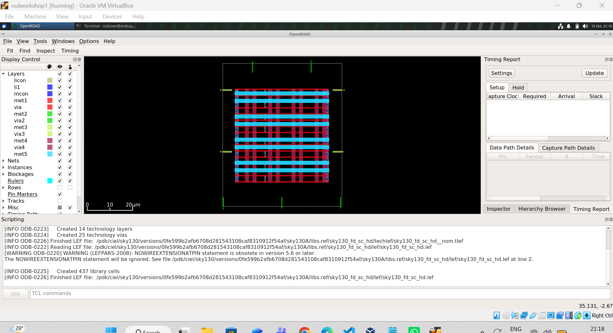
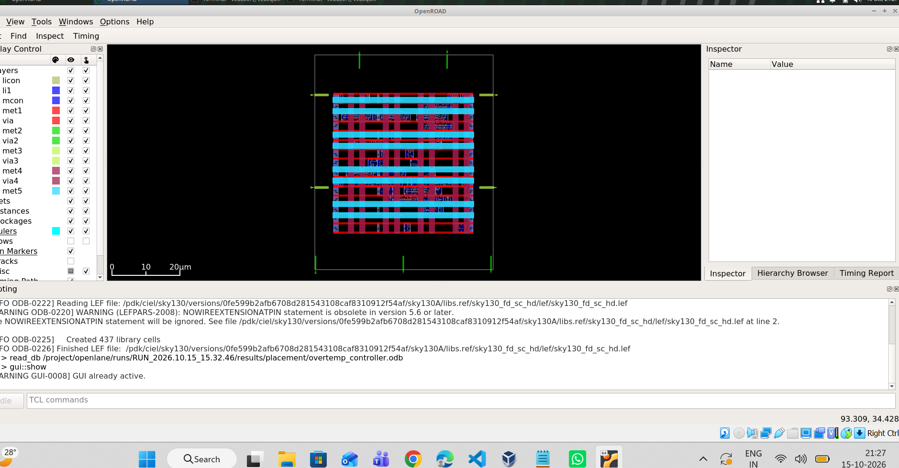
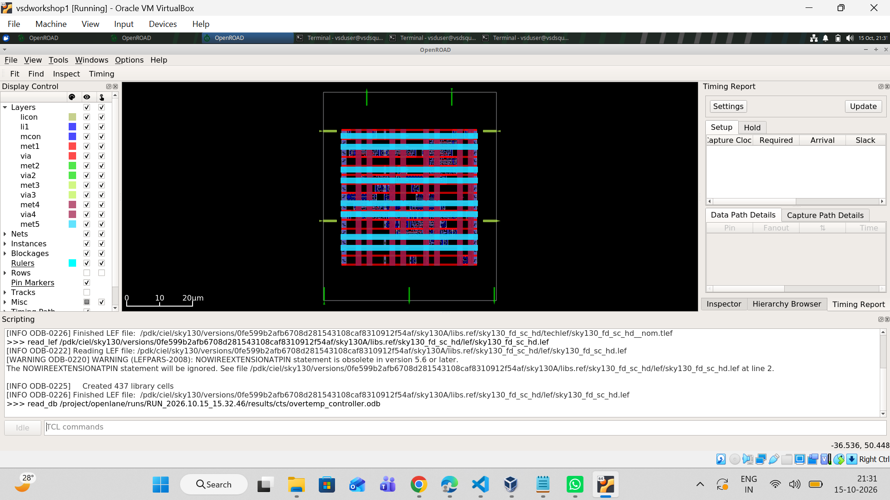
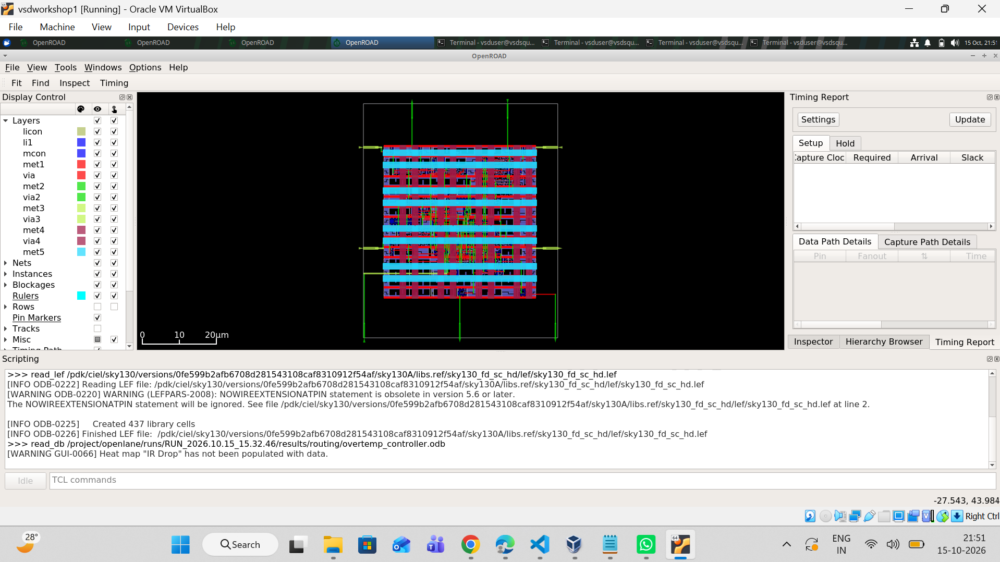
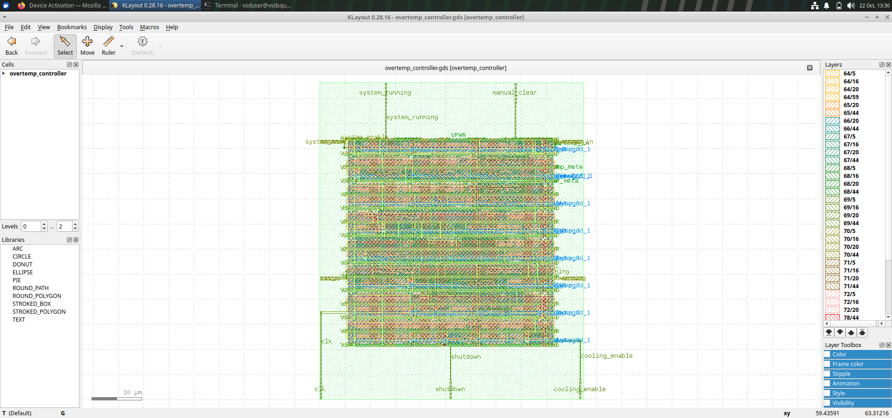
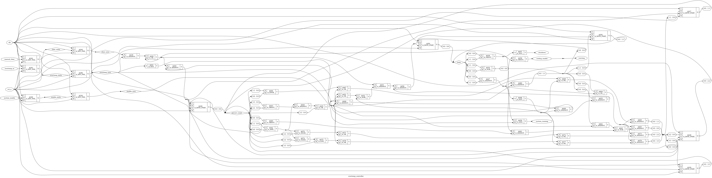
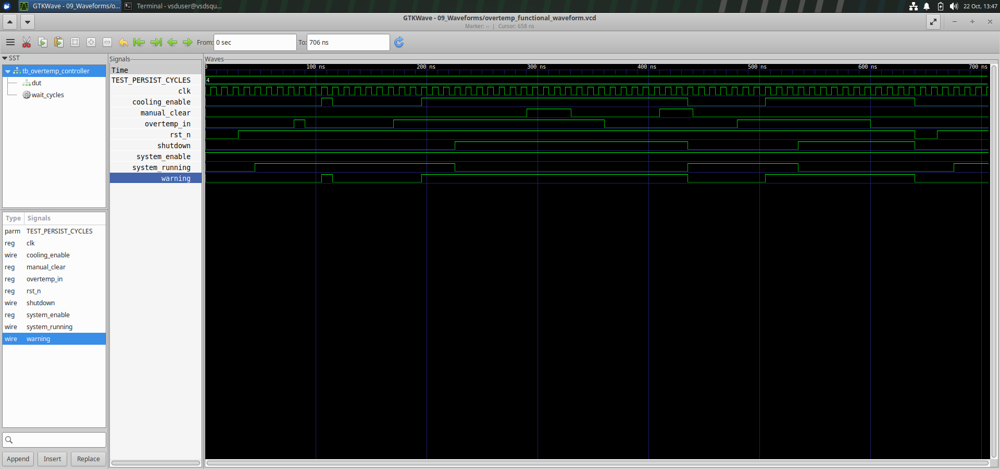

# Overtemperature Monitoring and Shutdown Controller ASIC

## Project Overview

This project implements an Overtemperature Monitoring and Shutdown Controller using Verilog RTL and the SKY130 High-Density standard-cell technology.

The controller monitors an overtemperature input, generates a warning, and shuts down normal operation when the overtemperature condition persists. It also supports a controlled manual clear after the temperature returns to a safe condition and reset-based recovery.

## Project Objectives

- Design the controller using synthesizable Verilog RTL.
- Verify normal operation, warning, shutdown, clear, and reset behaviour.
- Synthesize the design for the SKY130 HD standard-cell library.
- Run the OpenLane physical-design flow.
- Preserve physical-design outputs and verification reports.
- Evaluate timing using static timing analysis (STA) across library corners.

## Tools and Technology

- HDL: Verilog
- Synthesis: Yosys
- Physical-design flow: OpenLane 1.0.2
- Process technology: SKY130A / SKY130 HD
- Functional simulation: Icarus Verilog (where used for the testbench)
- Timing analysis: OpenSTA/OpenROAD timing tools
- Physical verification evidence: Magic DRC and antenna reports

## Repository Structure

| Directory | Contents |
|---|---|
| `01_RTL_Design/` | RTL source, SDC constraints, and OpenLane configuration |
| `02_Functional_Verification/` | Testbench and functional verification logs |
| `03_Synthesis/` | Yosys logs, synthesis reports, and constraint reports |
| `04_Physical_Design/` | GDS, DEF, LEF, and generated netlists |
| `05_Physical_Verification/` | DRC and antenna-check reports |
| `06_PostRoute_STA/` | Post-route parasitics, STA scripts, and timing summaries |
| `07_Reports_and_Presentation/` | Project report and presentation, when added |
| `08_Project_History/` | Final-results notes and RTL comparison experiments |

## Functional Verification

The existing testbench reports that all six scenarios passed:

1. Reset and normal operation
2. Rejection of a short overtemperature pulse
3. Shutdown after a persistent overtemperature warning
4. Blocking clear while overtemperature remains active
5. Manual clear after cooldown
6. Reset clears the latched shutdown

See `02_Functional_Verification/functional_test_results.txt`.

## Physical-Design Outputs

The repository includes the generated physical-design artifacts:

- GDSII layout: `overtemp_controller.gds`
- DEF design database: `overtemp_controller.def`
- LEF abstract: `overtemp_controller.lef`
- Synthesized netlist: `overtemp_controller.nl.v`
- Physical netlist: `overtemp_controller.pnl.v`

These files are provided as flow outputs. Their inclusion does not by itself establish foundry signoff.

## Physical Verification

The copied signoff reports include Magic DRC and antenna-check evidence. The original reports record zero Magic DRC violations and zero antenna net/pin violations for the reported run.

Refer to `05_Physical_Verification/` for the logs and detailed reports.

## Timing Analysis and Important Limitation

Timing results must be interpreted according to the analysis stage and constraints.

- The historical `FINAL_RESULTS.txt` reports mapped-netlist timing results.
- The post-route STA sweep uses the original routed database, SDC, and nominal extracted parasitics.
- In the recorded post-route library sweep, the `ss_n40C_1v28` corner has negative slack:
  - Setup worst slack: **-1.38 ns**
  - Hold worst slack: **-0.26 ns**
  - Setup TNS: **-4.74 ns**
- Other tested library variants in that sweep reported non-negative setup and hold slack.

**The design must not be described as passing every timing corner.** The failing corner is retained and disclosed for further timing investigation. The sweep uses nominal extracted parasitics and is not a complete signoff analysis across every library and every min/nominal/max parasitic combination.

See `06_PostRoute_STA/Library_Sweep/verification_summary.txt` and `06_PostRoute_STA/Corner_Reports/`.

## Reproducibility

The repository preserves the RTL, testbench, OpenLane configuration, constraints, synthesis logs, physical-design outputs, STA scripts, and available reports.

To reproduce the flow, install compatible versions of OpenLane, the SKY130A PDK, and the required tools, then use the configuration and RTL under `01_RTL_Design/`. Exact environment versions and paths may need adjustment on another machine.

## Project Status

Functional testbench: **Passed for the six recorded scenarios**

Physical verification: **Original reports record zero DRC and antenna violations**

Post-route timing: **A timing violation remains at `ss_n40C_1v28`**

This repository documents the available implementation evidence and the known limitation rather than claiming complete timing signoff.

## Acknowledgements

Prepared as an academic ASIC design project. Add the student name, roll number, department, university, and project guide details before submission, as required by the institution.

---

## Physical Design Visual Evidence

The following screenshots document the OpenLane physical-design stages.

### 1. Floorplan

### 2. Placement

### 3. Clock Tree Synthesis (CTS)

### 4. Routing

### 5. Final GDS Layout

## Yosys Synthesis Visualization

## Functional Simulation Waveforms

GTKWave waveform files are available in [`09_Waveforms`](09_Waveforms/):
- [Functional simulation waveform](09_Waveforms/overtemp_functional_waveform.vcd)
- [Mapped-netlist waveform](09_Waveforms/overtemp_mapped_waveform.vcd)

### GTKWave Functional Simulation Screenshot

